# Schema baze podataka

Ovaj dijagram prikazuje zavrsno stanje PostgreSQL baze nakon primjene
`db/schema/001_initial_schema.sql` i svih migracija iz `db/migrations/`, zakljucno
s `015_simplify_measurement_parameters.sql`.

Oznake uz stupce:

- `PK` - primarni kljuc
- `FK` - strani kljuc
- `UK` - jedinstvena vrijednost ili jedinstvena kombinacija

```mermaid
erDiagram
    STUDIOS {
        bigint id PK
        varchar name
        varchar timezone
        varchar status
        timestamptz created_at
        timestamptz updated_at
    }

    STUDIO_SETTINGS {
        bigint id PK
        bigint studio_id FK,UK
        varchar setting UK
        text value
        varchar value_type
        timestamptz created_at
        timestamptz updated_at
    }

    APP_USERS {
        bigint id PK
        varchar email UK
        text password_hash
        varchar status
        timestamptz last_login_at
        timestamptz created_at
        timestamptz updated_at
    }

    APP_USER_STUDIOS {
        bigint id PK
        bigint app_user_id FK,UK
        bigint studio_id FK,UK
        bigint member_id FK,UK
        bigint trainer_id FK,UK
        varchar status
        timestamptz joined_at
        timestamptz updated_at
    }

    APP_USER_STUDIO_ROLES {
        bigint app_user_studio_id PK,FK
        varchar role PK
        timestamptz created_at
    }

    APP_USER_DEVICE_TOKENS {
        bigint id PK
        bigint app_user_id FK
        text token UK
        varchar platform
        timestamptz created_at
        timestamptz updated_at
    }

    MEMBERS {
        bigint id PK
        bigint studio_id FK,UK
        varchar first_name
        varchar last_name
        varchar email UK
        varchar phone
        date date_of_birth
        varchar status
        timestamptz created_at
        timestamptz updated_at
    }

    TRAINERS {
        bigint id PK
        bigint studio_id FK,UK
        varchar first_name
        varchar last_name
        varchar email UK
        varchar phone
        text bio
        varchar status
        timestamptz created_at
        timestamptz updated_at
    }

    CLASS_TYPES {
        bigint id PK
        bigint studio_id FK,UK
        varchar name UK
        text description
        integer default_duration_minutes
        integer default_capacity
        varchar difficulty_level
        varchar status
        timestamptz created_at
        timestamptz updated_at
    }

    RECURRING_CLASS_SCHEDULES {
        bigint id PK
        bigint studio_id FK
        bigint class_type_id FK
        bigint trainer_id FK
        smallint day_of_week
        time starts_at_time
        integer duration_minutes
        integer capacity
        date valid_from
        date valid_until
        varchar status
        date status_effective_from
        timestamptz created_at
        timestamptz updated_at
    }

    CLASS_SESSIONS {
        bigint id PK
        bigint studio_id FK
        bigint class_type_id FK
        bigint trainer_id FK
        bigint recurring_schedule_id FK
        timestamptz starts_at
        timestamptz ends_at
        integer capacity
        varchar status
        varchar cancellation_reason
        timestamptz created_at
        timestamptz updated_at
    }

    MEMBER_FIXED_SCHEDULES {
        bigint id PK
        bigint studio_id FK
        bigint member_id FK
        bigint recurring_schedule_id FK
        date starts_on
        date ends_on
        varchar status
        timestamptz created_at
        timestamptz updated_at
    }

    BOOKINGS {
        bigint id PK
        bigint studio_id FK
        bigint member_id FK
        bigint class_session_id FK
        varchar status
        varchar booking_source
        varchar cancellation_reason
        timestamptz booked_at
        timestamptz cancelled_at
        timestamptz attended_at
        timestamptz created_at
        timestamptz updated_at
    }

    MEMBERSHIP_PLANS {
        bigint id PK
        bigint studio_id FK,UK
        varchar name UK
        text description
        integer session_limit
        varchar session_limit_period
        numeric price_amount
        varchar currency
        integer billing_period_months
        varchar status
        timestamptz created_at
        timestamptz updated_at
    }

    MEMBER_MEMBERSHIPS {
        bigint id PK
        bigint studio_id FK
        bigint member_id FK
        bigint membership_plan_id FK
        date starts_on
        date ends_on
        date billing_starts_on
        date next_billing_on
        timestamptz created_at
        timestamptz updated_at
    }

    MEMBERSHIP_PAYMENT_OBLIGATIONS {
        bigint id PK
        bigint studio_id FK
        bigint member_membership_id FK,UK
        date period_starts_on UK
        date period_ends_on
        date due_on
        varchar plan_name
        numeric full_amount
        numeric amount_due
        varchar currency
        varchar status
        varchar recipient_name
        varchar iban
        varchar payment_model
        varchar payment_reference
        varchar payment_description
        timestamptz reported_at
        bigint reported_by_user_id FK
        timestamptz confirmed_at
        bigint confirmed_by_user_id FK
        timestamptz created_at
        timestamptz updated_at
    }

    APP_NOTIFICATIONS {
        bigint id PK
        bigint studio_id FK
        bigint app_user_id FK
        bigint payment_obligation_id FK
        varchar notification_type
        integer day_offset
        varchar title
        text body
        timestamptz read_at
        timestamptz pushed_at
        timestamptz created_at
    }

    MEASUREMENT_PARAMETERS {
        bigint id PK
        bigint studio_id FK,UK
        varchar code UK
        varchar name
        varchar unit
        integer sort_order
        varchar status
        timestamptz created_at
        timestamptz updated_at
    }

    MEMBER_MEASUREMENTS {
        bigint id PK
        bigint studio_id FK
        bigint member_id FK
        bigint recorded_by_user_id FK
        timestamptz measured_at
        text note
        timestamptz created_at
        timestamptz updated_at
    }

    MEMBER_MEASUREMENT_VALUES {
        bigint id PK
        bigint measurement_id FK,UK
        bigint parameter_id FK,UK
        numeric numeric_value
        timestamptz created_at
        timestamptz updated_at
    }

    STUDIOS ||--o{ STUDIO_SETTINGS : has
    STUDIOS ||--o{ APP_USER_STUDIOS : contains
    APP_USERS ||--o{ APP_USER_STUDIOS : joins
    APP_USER_STUDIOS ||--o{ APP_USER_STUDIO_ROLES : has
    MEMBERS o|--o| APP_USER_STUDIOS : profile
    TRAINERS o|--o| APP_USER_STUDIOS : profile
    APP_USERS ||--o{ APP_USER_DEVICE_TOKENS : registers

    STUDIOS ||--o{ MEMBERS : has
    STUDIOS ||--o{ TRAINERS : has
    STUDIOS ||--o{ CLASS_TYPES : defines
    CLASS_TYPES ||--o{ RECURRING_CLASS_SCHEDULES : schedules
    TRAINERS ||--o{ RECURRING_CLASS_SCHEDULES : leads
    RECURRING_CLASS_SCHEDULES o|--o{ CLASS_SESSIONS : generates
    CLASS_TYPES ||--o{ CLASS_SESSIONS : categorizes
    TRAINERS ||--o{ CLASS_SESSIONS : leads
    MEMBERS ||--o{ MEMBER_FIXED_SCHEDULES : receives
    RECURRING_CLASS_SCHEDULES ||--o{ MEMBER_FIXED_SCHEDULES : assigns
    MEMBERS ||--o{ BOOKINGS : makes
    CLASS_SESSIONS ||--o{ BOOKINGS : receives

    STUDIOS ||--o{ MEMBERSHIP_PLANS : defines
    MEMBERS ||--o{ MEMBER_MEMBERSHIPS : owns
    MEMBERSHIP_PLANS ||--o{ MEMBER_MEMBERSHIPS : instantiates
    MEMBER_MEMBERSHIPS ||--o{ MEMBERSHIP_PAYMENT_OBLIGATIONS : bills
    APP_USERS o|--o{ MEMBERSHIP_PAYMENT_OBLIGATIONS : reports
    APP_USERS o|--o{ MEMBERSHIP_PAYMENT_OBLIGATIONS : confirms
    MEMBERSHIP_PAYMENT_OBLIGATIONS o|--o{ APP_NOTIFICATIONS : triggers
    APP_USERS ||--o{ APP_NOTIFICATIONS : receives

    STUDIOS ||--o{ MEASUREMENT_PARAMETERS : defines
    MEMBERS ||--o{ MEMBER_MEASUREMENTS : has
    APP_USERS o|--o{ MEMBER_MEASUREMENTS : records
    MEMBER_MEASUREMENTS ||--o{ MEMBER_MEASUREMENT_VALUES : contains
    MEASUREMENT_PARAMETERS ||--o{ MEMBER_MEASUREMENT_VALUES : describes
```

## Poslovne cjeline

| Cjelina | Glavne tablice |
| --- | --- |
| Studio i konfiguracija | `studios`, `studio_settings` |
| Racuni i ovlasti | `app_users`, `app_user_studios`, `app_user_studio_roles`, `app_user_device_tokens` |
| Clanovi i treneri | `members`, `trainers` |
| Raspored i rezervacije | `class_types`, `recurring_class_schedules`, `class_sessions`, `member_fixed_schedules`, `bookings` |
| Clanarine i naplata | `membership_plans`, `member_memberships`, `membership_payment_obligations`, `app_notifications` |
| Mjerenja napretka | `measurement_parameters`, `member_measurements`, `member_measurement_values` |

## Vazna ogranicenja

- Podaci studija odvojeni su pomocu `studio_id`; nazivi paketa, vrste treninga i
  e-mailovi profila jedinstveni su unutar studija.
- Globalni korisnicki racun jedinstven je po normaliziranom e-mailu, a pristup
  pojedinom studiju i uloge cuvaju se odvojeno.
- Za clana i termin moze postojati samo jedna aktivna rezervacija.
- Termin generiran iz ponavljajuceg rasporeda jedinstven je po rasporedu i
  vremenu pocetka.
- Jedno mjerenje moze imati najvise jednu vrijednost za svaki mjerni parametar.
- Obracun clanarine jedinstven je po clanstvu i pocetku obracunskog razdoblja.
- `CHECK` ogranicenja u SQL migracijama provjeravaju statuse, pozitivne iznose,
  vremenske raspone, valutu i dopustene vrste vrijednosti.

Izvor istine za izvrsivu strukturu ostaju SQL datoteke u `db/schema/` i
`db/migrations/`; ovaj dokument je citljiv pregled njihove konacne strukture.
